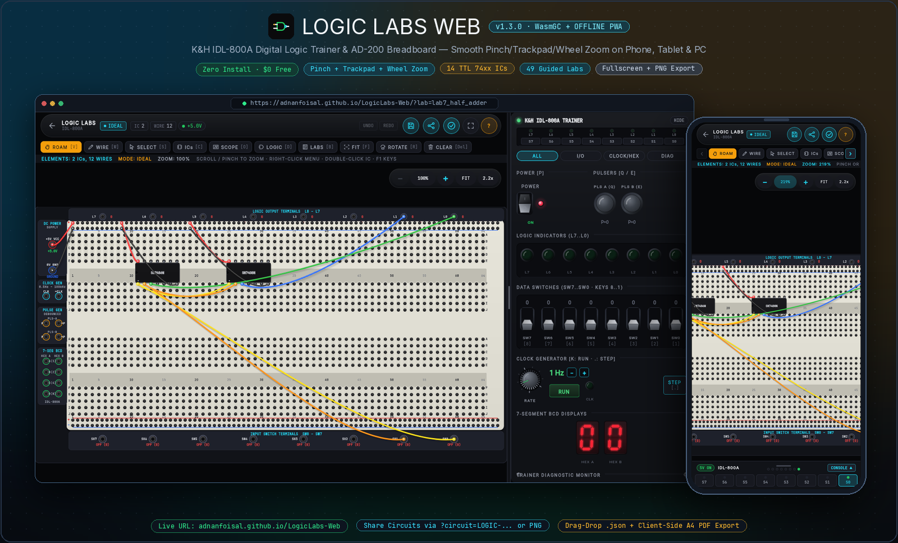
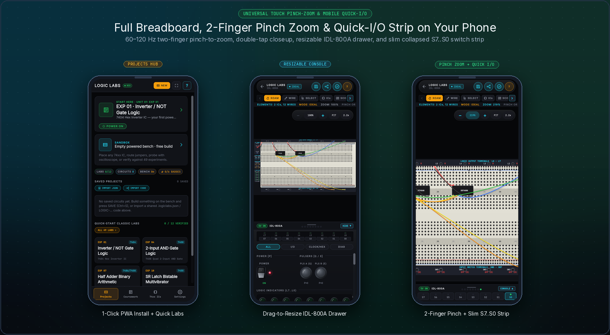
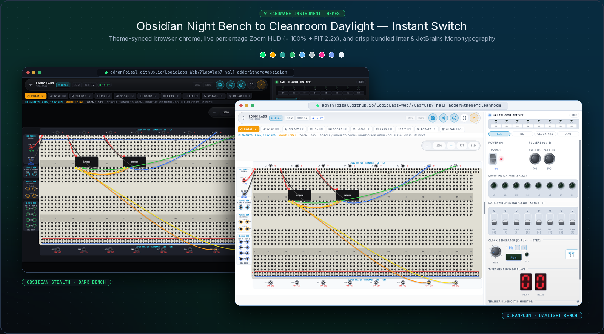
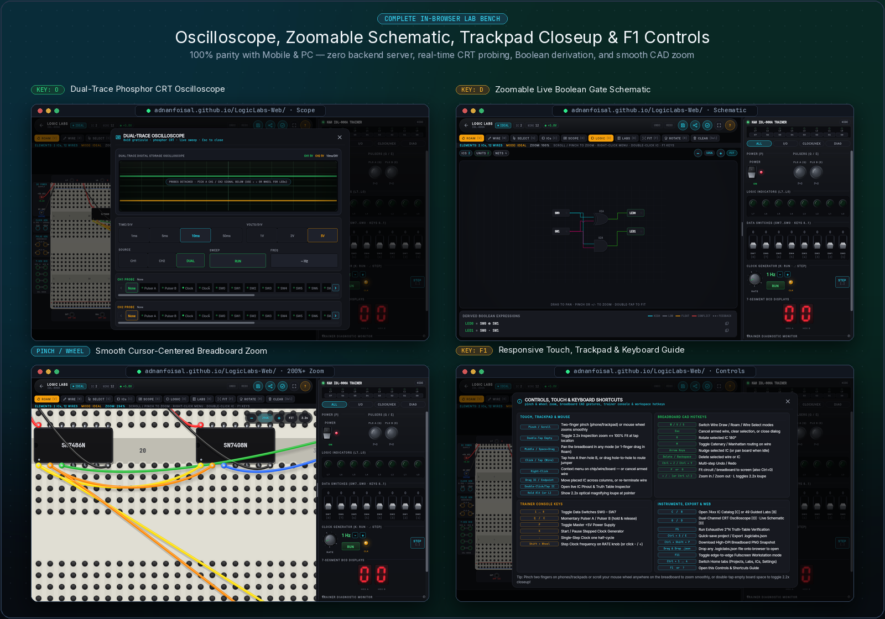
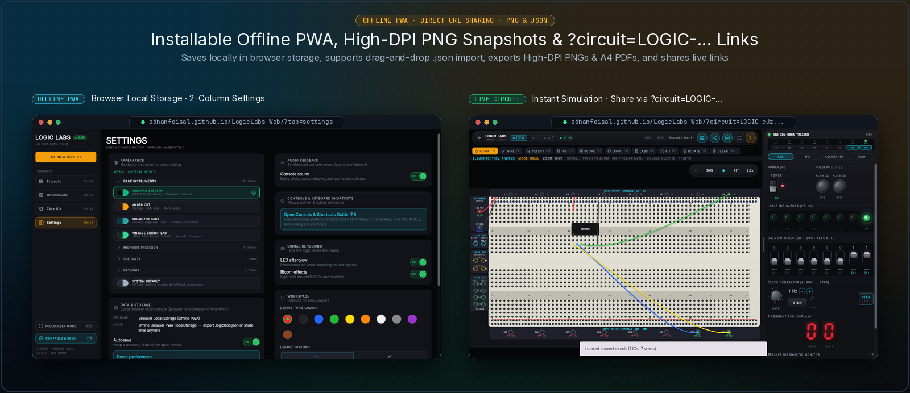
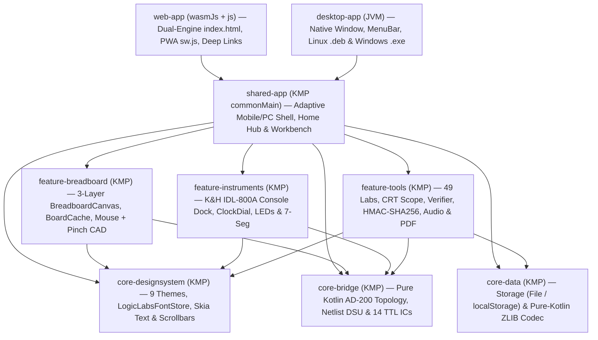

<div align="center">

<a href="https://adnanfoisal.github.io/LogicLabs-Web/">
  
</a>

<br />
<br />

# Logic Labs — Web & Multiplatform Edition

**The full K&H IDL-800A Digital Logic Trainer & AD-200 Breadboard simulator — running 100% offline in any browser on phones, tablets, Chromebooks, Linux, Windows, and macOS.**

### [Launch Logic Labs Web Live → `https://adnanfoisal.github.io/LogicLabs-Web/`](https://adnanfoisal.github.io/LogicLabs-Web/)

[](https://adnanfoisal.github.io/LogicLabs-Web/)
[](https://github.com/AdnanFoisal/LogicLabs-Web/actions/workflows/deploy-web.yml)
[](#how-the-dual-engine-works)
[](#install-as-an-offline-app-pwa)
[](LICENSE)

<p>
  <a href="#quick-launch-links">Quick Launch Links</a> &nbsp;·&nbsp;
  <a href="#visual-tour">Screenshots</a> &nbsp;·&nbsp;
  <a href="#install-as-an-offline-app-pwa">Install Offline PWA</a> &nbsp;·&nbsp;
  <a href="#share-live-circuits-via-url">URL Circuit Sharing</a> &nbsp;·&nbsp;
  <a href="#controls--shortcuts">Controls</a> &nbsp;·&nbsp;
  <a href="#navigating-this-repository">Repository Guide</a> &nbsp;·&nbsp;
  <a href="#build--host-for-free">Build &amp; Free Hosting</a>
</p>

</div>

---

## Why Logic Labs Web?

Built as a **unified Kotlin Multiplatform + Compose Multiplatform** codebase sharing ~93% of its code across **Web (WasmGC + JS fallback)**, **Linux Mint**, and **Windows 10/11**, Logic Labs Web delivers **100% feature parity** with the [Android](https://github.com/AdnanFoisal/LogicLabs) and [Desktop](https://github.com/AdnanFoisal/LogicLabs-Desktop) editions — with **zero installation, zero backend servers, zero accounts, and $0 hosting cost**:

- **Works on Every Device:** Automatic **Dual-Mode Adaptive UI** switches seamlessly between the side-by-side PC/tablet CAD workstation (`≥ 840 dp`) and a touch-first mobile phone bench (`< 840 dp`) with bottom navigation, pinch-to-zoom breadboard, and a collapsible bottom Trainer Console drawer.
- **Dual-Engine Browser Compatibility:** Automatically probes **WebAssembly GC (`wasmJs`)** in `< 1 ms` for near-native speed on Chrome 119+, Edge 119+, Firefox 120+, and Safari 18.2+, and seamlessly falls back to **Kotlin/JS IR** on older iPhones (iOS 15–18.1) and older Chromebooks.
- **100% Offline After First Load (PWA):** Service Worker caches fonts and engine assets locally — works in university exam labs or offline laptops with zero Wi-Fi.
- **Complete Lab Instrumentation Built In:** 14 TTL 74xx ICs, 49 guided coursework labs, Dual-Trace Phosphor CRT Oscilloscope, Live Gate-Level Boolean Schematic, Exhaustive $2^N$ Truth-Table Verifier with **HMAC-SHA256** verification seal & **in-browser A4 PDF certificate download**, procedural **Web Audio** console SFX, and 9 hardware themes.

---

## Quick Launch Links

Jump straight into any part of the live workstation from your browser:

| Destination | Direct Link |
| :--- | :--- |
| **Projects Hub & Quick-Start Labs** | [adnanfoisal.github.io/LogicLabs-Web/](https://adnanfoisal.github.io/LogicLabs-Web/) |
| **Half Adder Binary Arithmetic (Lab 7)** | [Open Lab 7 Live](https://adnanfoisal.github.io/LogicLabs-Web/?lab=lab7_half_adder) |
| **49 Guided Coursework Labs** | [Browse Coursework](https://adnanfoisal.github.io/LogicLabs-Web/?tab=coursework) |
| **14 TTL 74xx Interactive Datasheets** | [Open 74xx Reference](https://adnanfoisal.github.io/LogicLabs-Web/?tab=ics) |
| **Cleanroom Daylight High-Contrast Bench** | [Open Daylight Lab](https://adnanfoisal.github.io/LogicLabs-Web/?lab=lab7_half_adder&theme=cleanroom) |
| **Compatibility JS Engine (Older Browsers)** | [Force JS Fallback Mode](https://adnanfoisal.github.io/LogicLabs-Web/?engine=js) |

> **Prefer an installed native PC binary?** Grab the Linux Mint `.deb`/Portable or Windows 10/11 Portable releases from [**LogicLabs-Desktop**](https://github.com/AdnanFoisal/LogicLabs-Desktop/releases/latest), or Android APK from [**LogicLabs**](https://github.com/AdnanFoisal/LogicLabs).

---

## Visual Tour

### Adaptive Mobile & Touch Bench — Built for Phones Too
Below `840 dp`, Logic Labs automatically switches to a compact hardware top bar, bottom navigation bar (`Projects`, `Coursework`, `74xx ICs`, `Settings`), full-width pinch-to-zoom AD-200 breadboard, and a collapsible bottom IDL-800A Trainer Console drawer with an always-visible `L7..L0` live LED status bar.

<div align="center">
  
</div>

### 9 Hardware Chassis Finishes (Obsidian Night Bench to Cleanroom Daylight)
Rendered with the exact same Skia engine and bundled `Inter` + `JetBrains Mono` typography across WasmGC, JS fallback, and native Desktop.

<div align="center">
  
</div>

### Complete In-Browser Lab Instrumentation
Dual-Trace CRT Oscilloscope (`O`), Live Gate-Level Boolean Schematic (`D`), Interactive 14-Chip 74xx DIP Datasheets (`Ctrl+3`), and Built-In `F1` Mouse CAD & Keyboard Shortcuts Guide.

<div align="center">
  
</div>

### 100% Offline PWA Storage & Direct `?circuit=LOGIC-...` Links
Projects, autosave drafts, settings, and lab verification progress persist locally in browser storage (`localStorage`), with instant `.logiclabs.json` download/upload, client-side A4 `.pdf` certificate download, and 1-click shareable circuit URLs.

<div align="center">
  
</div>

---

## Install as an Offline App (PWA)

Once opened once, Logic Labs Web works completely offline and installs like a native app on any device:

| Device / Browser | How to Install Offline |
| :--- | :--- |
| **Android (Chrome / Edge / Brave)** | Open the live link → tap **Menu (`⋮`) → Install app** (or tap the install banner) |
| **iPhone / iPad (Safari)** | Open the live link → tap **Share (`↑`) → Add to Home Screen** |
| **Linux Mint / Windows / macOS / Chromebook (Chrome / Edge)** | Click the **Install icon (`⊕`)** on the right side of the browser address bar |

---

## Share Live Circuits via URL

Logic Labs Web is **100% binary-compatible** with Android & Desktop `LOGIC-...` share codes (using pure-Kotlin RFC 1950/1951 ZLIB compression):

1. Build any circuit on the breadboard and click **Share** in the top bar.
2. Click **COPY DIRECT LINK** to copy a clickable URL like:
   ```text
   https://adnanfoisal.github.io/LogicLabs-Web/?circuit=LOGIC-eJz...
   ```
3. Send the link in class chat, Discord, or lab assignments — anyone clicking it lands straight on the live wired breadboard!
4. You can also paste either a `LOGIC-...` code **or** a full shared URL into **Projects → IMPORT CODE** on Web or Desktop.

---

## Controls & Shortcuts

Press **`F1`** or tap **`?`** anywhere inside the app for the built-in interactive reference.

<details open>
<summary><strong>Touch, Trackpad &amp; Mouse Pointer Controls</strong></summary>

| Action | PC Mouse &amp; Laptop Trackpad | Phone / Tablet Touch |
| :--- | :--- | :--- |
| **Zoom breadboard / schematic** | `Scroll Wheel`, **Two-Finger Trackpad Pinch**, or `Ctrl +` / `−` / `0` | **Two-Finger Pinch**, **Double-Tap Empty Board** (`2.2×`), or `−` / `+` HUD |
| **Pan breadboard** | `Middle-Drag`, `Space + Drag`, or `Left-Drag` in Roam | **1-Finger Drag** on empty board / Two-finger pan |
| **Draw jumper wire** | Click hole A → B or Click-Drag (Wire mode `W`) | Tap hole A → B or Drag (Wire mode) |
| **Move IC / re-wire pin** | Drag IC body or wire endpoint | Drag IC body or wire endpoint |
| **IC Pinout Inspector** | `Double-Click` any placed IC | `Double-Tap` any placed IC |
| **2.2× Optical Loupe** | Hold `Alt` or press `L` | Tap `2.2×` button on Zoom HUD |
| **Quick I/O while collapsed** | Resizable right-hand IDL-800A rack | Tap **`HIDE ▼`** for slim `5V` + `S7..S0` + `L7..L0` strip (or drag handle to resize) |

</details>

<details>
<summary><strong>Full Keyboard Shortcuts &amp; Web Exports (PC &amp; Chromebook)</strong></summary>

| Category | Key(s) | Action |
| :--- | :--- | :--- |
| **Tools & Editing** | `W` / `V` / `S` / `R` / `M` / `Del` | Wire / Roam / Select / Rotate IC 180° / Manhattan Wire / Delete |
| **Zoom & Fullscreen** | `Ctrl +/-/0` · `F` · `+` / `-` · `L` · `F11` | Zoom In/Out/Reset · Fit board · 2.2× Loupe · **Fullscreen Mode** |
| **IDL-800A Console** | `1..8` / `Q` / `E` / `P` / `K` / `.` | Data Switches `SW0..SW7` / Pulsers A & B / Power / Clock Run / Step |
| **Instruments** | `C` / `B` / `O` / `D` / `F5` / `F1` | 74xx Chips / 49 Labs / CRT Scope / Live Schematic / Verify / Help |
| **Save, PNG & Drag-Drop** | `Ctrl+S` / `Ctrl+E` / `Ctrl+Shift+P` | Save project / Export `.json` / **Download High-DPI PNG** (or drop `.json` onto window) |

</details>

---

## How the Dual Engine Works

`index.html` runs a `< 1 ms` WebAssembly GC feature probe before downloading any application bundle:
- **Modern browsers** (Chrome 119+, Edge 119+, Firefox 120+, Safari 18.2+ / iOS 18.2+) download only **`logic-labs-wasm.js` + `.wasm`** (`Kotlin/WasmGC + Skiko`, ~1.8 MB gzipped) for snappy near-native execution.
- **Older devices** (older iPhones on iOS 15–18.1, older Chromebooks, or restricted WebViews) automatically load **`skiko.js` + `logic-labs-js.js`** (`Kotlin/JS IR + Skiko`) — or fall back transparently if Wasm initialization ever fails.

---

## Navigating This Repository

This repository is a **unified 11-module Kotlin Multiplatform workspace** targeting **Web (`wasmJs` + `js`)** and **Desktop (`jvm` — Linux Mint, Windows 10/11, macOS)** from one shared `commonMain` source of truth:



### Quick Module Map

| Directory | Targets | Responsibility |
| :--- | :---: | :--- |
| [`web-app/`](web-app/) | `wasmJs`, `js` | Browser entry points, font preloader, URL deep-link router, `index.html`, `sw.js`, `manifest.webmanifest`, `_headers` |
| [`shared-app/`](shared-app/) | `jvm`, `wasmJs`, `js` | All shared UI screens (`HomeScreen`, `CourseworkTab`, `IcReferenceTab`, `SettingsScreen`, `LogicLabsMainScreen`) + `AppPlatform` |
| [`desktop-app/`](desktop-app/) | `jvm` | Native desktop window (`Main.kt`), MenuBar, fat JAR packagers, visual & performance test suites |
| [`core-bridge/`](core-bridge/) | `jvm`, `wasmJs`, `js` | Pure Kotlin AD-200 breadboard netlist DSU, 14 TTL 74xx IC models, `IDEAL` vs `PRACTICAL` physics |
| [`core-data/`](core-data/) | `jvm`, `wasmJs`, `js` | `LogicLabsStorage` (`File` + `localStorage`), pure-Kotlin RFC 1950/1951 ZLIB `LOGIC-...` share codec |
| [`core-designsystem/`](core-designsystem/) | `jvm`, `wasmJs`, `js` | 9 `HardwareTheme` palettes, `LogicLabsFontStore`, Skia `DesktopTextPaint`, `DesktopScrollbars` |
| [`feature-breadboard/`](feature-breadboard/) | `jvm`, `wasmJs`, `js` | 3-layer `BreadboardCanvas`, offscreen rasterized `BoardCache`, `DipPainter`, `WirePainter`, mouse + touch gestures |
| [`feature-instruments/`](feature-instruments/) | `jvm`, `wasmJs`, `js` | K&H IDL-800A `TrainerConsoleDock`, `ClockDial`, switches, pulsers, LEDs, dual 7-segment displays |
| [`feature-tools/`](feature-tools/) | `jvm`, `wasmJs`, `js` | 49 guided labs, CRT Oscilloscope, Live Boolean Schematic, $2^N$ Verifier, pure-Kotlin HMAC-SHA256, Web Audio / Java Sound SFX, A4 PDF writers |
| [`packaging/`](packaging/) | Linux / Win | Cross-platform desktop `.deb`, portable `.tar.gz`, and Windows `.zip` packagers |
| [`.github/workflows/`](.github/workflows/) | CI / Pages | Auto-deploy GitHub Pages (`deploy-web.yml`), multiplatform PR CI (`ci-build.yml`), Windows installer (`build-windows.yml`) |

---

## Build & Host for Free

### Run Locally (Requires JDK 21)

```bash
git clone https://github.com/AdnanFoisal/LogicLabs-Web.git
cd LogicLabs-Web

# Live Web dev server (WasmGC)
./gradlew :web-app:wasmJsBrowserDevelopmentRun

# Build combined dual-engine (WasmGC + JS) offline PWA static site
./gradlew :web-app:assembleCombinedWebDist
# Ready to serve from: web-app/build/dist/combined/

# Run Native Desktop JVM app from the same repo
./gradlew :desktop-app:run

# Run full JVM unit, crypto, ZLIB interop, performance & visual audit test suite
./gradlew :core-bridge:jvmTest :core-data:jvmTest :core-designsystem:jvmTest \
  :feature-breadboard:jvmTest :feature-tools:jvmTest :core-testing:test :desktop-app:test
```

### Free Hosting Options ($0/Month Forever)

1. **GitHub Pages (Already Configured):**
   Every push to `main` runs [`.github/workflows/deploy-web.yml`](.github/workflows/deploy-web.yml), verifies all tests, builds both `wasmJs` + `js` bundles, and publishes to `https://<username>.github.io/LogicLabs-Web/`.
2. **Cloudflare Pages (Optional Unlimited Bandwidth + Brotli `.wasm` Mirror):**
   Connect this repo in Cloudflare Pages with build command `./gradlew :web-app:assembleCombinedWebDist --no-daemon` and output directory `web-app/build/dist/combined`. The included [`_headers`](web-app/src/webMain/resources/_headers) file automatically enables immutable long-term edge caching for `.wasm` and `.ttf` assets.

---

## Contributing, Changelog & License

- See [**`CHANGELOG.md`**](CHANGELOG.md) for release notes and [**`CONTRIBUTING.md`**](CONTRIBUTING.md) for developer onboarding.
- Licensed under **GPL-3.0-only** — see [`LICENSE`](LICENSE) and [`THIRD_PARTY_NOTICES.md`](THIRD_PARTY_NOTICES.md).
- Original **Logic Labs** Android app by [**Adnan Foisal (CUET CSE)**](https://github.com/AdnanFoisal/LogicLabs); desktop port at [**LogicLabs-Desktop**](https://github.com/AdnanFoisal/LogicLabs-Desktop).
- `:core-digital` legacy reference kernel derived from [**hneemann/Digital**](https://github.com/hneemann/Digital) (GPL-3.0).
